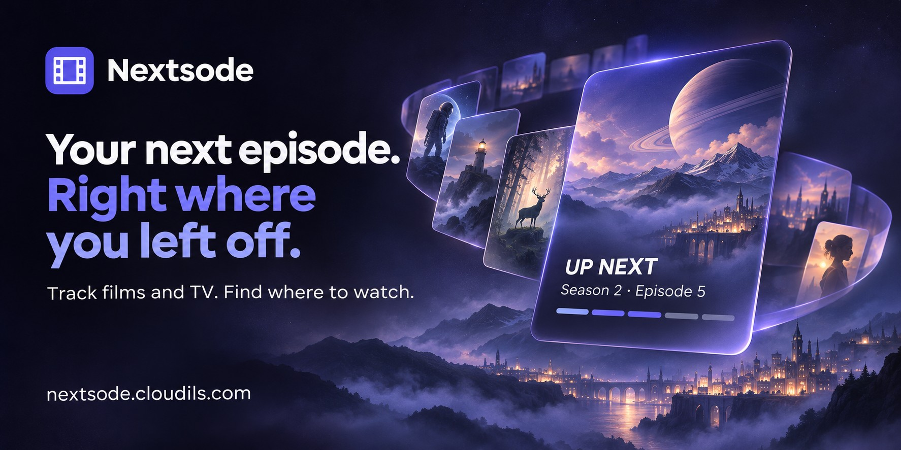
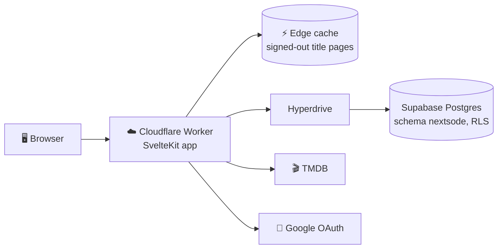

<p align="center">
  
</p>

<p align="center">
  <a href="https://github.com/Isma-L154/nextsode/actions/workflows/ci.yml"></a>
  <a href="https://github.com/Isma-L154/nextsode/actions/workflows/security.yml"></a>
  
  
  
  
</p>

<p align="center">
  <b>Search films and TV, save them, and never lose your place in a series.</b><br>
  Progress tracked down to the episode you stopped on, streaming availability in your
  country, and suggestions drawn from your own list.
</p>

<p align="center">
  <a href="https://nextsode.cloudils.com">Live demo</a> ·
  <a href="https://github.com/Isma-L154/nextsode/issues">Report a bug</a> ·
  <a href="#running-locally">Run it locally</a>
</p>

---

## What it does

- **Sign in with Google** — your list is private to your account.
- **Search and trending**, proxied server-side so the TMDB token never reaches the browser.
- **Suggestions from your list** — rows of "because you watched X", built from what you actually finished rather than from what is popular this week.
- **Season and episode tracking** — a bookmark down to the episode, and nothing that has not aired can be ticked off, so a show is never marked watched ahead of broadcast. Finishing the aired seasons marks you _caught up_, and a new season brings the show back on its own. ([design notes](docs/season-progress.md))
- **Where to watch** — streaming, rental and purchase options for your country.
- **Coming soon** — pending films and seasons grouped by how soon they arrive.
- **Auto-delete** — optionally clear watched titles off your list after 7, 30 or 90 days. Off by default, each card warns you for the last week with a one-tap **Keep**, and anything with a new season on the way is never touched.

## How it works



The browser talks to the Worker and nothing else — every credential stays inside
it.

Two conventions carry most of the codebase: decision logic lives in
`src/lib/domain` as pure functions with their own unit tests, and anything under
`src/lib/server` can never reach the browser. Upkeep (refreshing season data,
deleting expired titles) runs on page load rather than on a timer, so there is
no cron job to operate.

**Stack:** SvelteKit 3 · Svelte 5 · TypeScript · Tailwind 4 · Drizzle + Supabase Postgres via Hyperdrive ·
Cloudflare Workers

## Running locally

Needs Node 24+, a free [TMDB](https://www.themoviedb.org/settings/api) token and
a Google OAuth client, and Docker for local Postgres.

```bash
npm install
cp .env.example .env    # fill in the values below
npm run db:local        # reads .env, starts Postgres and sets the local app-role password
npm run db:migrate      # owner connection; reviewed migrations only
npm run dev             # http://localhost:5173
```

The app reaches that container as `nextsode_app` through the Hyperdrive
binding's `localConnectionString` in `wrangler.jsonc`, which `vite dev`,
`wrangler dev`, the tests and the build use and a deploy never does.
`db:local` reads the owner credentials and port from `DATABASE_URL` in `.env`,
and the app-role password from that Wrangler binding. Create `.env` before
starting the container; the script loads it automatically.

| Variable               | Description                                                                                      |
| ---------------------- | ------------------------------------------------------------------------------------------------ |
| `TMDB_ACCESS_TOKEN`    | TMDB v4 **API Read Access Token** (Bearer).                                                      |
| `DATABASE_URL`         | Local Docker owner credentials and port for `db:local`; schema owner connection for drizzle-kit. |
| `TEST_DATABASE_URL`    | Owner connection for Vitest; the same local container, with a fresh database per test.           |
| `GOOGLE_CLIENT_ID`     | OAuth 2.0 client ID.                                                                             |
| `GOOGLE_CLIENT_SECRET` | OAuth 2.0 client secret.                                                                         |
| `OAUTH_ORIGIN`         | _Optional._ Public origin for the redirect URI; derived from the request if unset.               |

> ⚠️ `.env` is git-ignored and must never be committed.

**Google sign-in:** in the
[Cloud Console](https://console.cloud.google.com/apis/credentials), create an
OAuth client ID for a Web application and add one redirect URI per environment —
`http://localhost:5173/auth/google/callback` and
`https://<your-domain>/auth/google/callback`. Only `openid`, `profile` and
`email` are requested, and no Google tokens are stored.

Server tests use `supabase/postgres:17.11.0.018`, the same image as CI. Run
`npm run db:local` first and export `TEST_DATABASE_URL` from `.env` in the shell
running Vitest. The server setup fails clearly when it is absent; tests create
and drop isolated databases from a migrated `nextsode_template`, connecting as
`nextsode_app` with the same password as the dev server.

Schema changes use `npm run db:generate` and `npm run db:migrate`;
`npm run db:studio` opens the owner connection for inspection.

Other scripts: `npm run lint`, `npm run check`, `npm run test:unit`,
`npm run test:e2e`.

`npm run brand` regenerates the site's link preview and search image
(`static/og.png`) from `docs/brand/banner.html`. It is drawn rather than
painted — same palette, typefaces and film mark as the app — so editing that
file and re-running the script is how it changes. The README banner,
`docs/brand/banner.jpg`, is a painted promotional image and is replaced by hand.

`npm run gen` regenerates `worker-configuration.d.ts` from the bindings in
`wrangler.jsonc`. Run it when you add or change a binding, and commit the
result. Run it on a clean tree: `wrangler types` adds an extra `GlobalProps`
interface pointing at the built worker when `.svelte-kit/cloudflare/_worker.js`
happens to exist, so regenerating after a build produces a file that differs
from the one CI generates.

## Deployment

Pushes to `main` deploy to Cloudflare automatically once CI passes. That needs
one repository secret, `CLOUDFLARE_API_TOKEN` (Cloudflare → My Profile → API
Tokens → template _Edit Cloudflare Workers_).

The Worker uses Drizzle with node-postgres through Hyperdrive. Each request
creates a pool with at most one connection and closes it after the response.

First-time setup:

1. Apply `npm run db:migrate` with `DATABASE_URL` set to the Supabase direct connection as the schema owner, `postgres`, ending in `?uselibpqcompat=true&sslmode=require` (Supabase's certificate chain is not in Node's trust store, and plain connections are refused). Migrations use only `nextsode`, including the migrations journal; they do not touch `public` or Supabase-managed schemas.
2. Set `nextsode_app`'s password and `LOGIN` outside migrations, ideally as a SCRAM-SHA-256 verifier computed locally so the plain password never reaches the database. It must remain a non-owner role without `BYPASSRLS` or superuser privileges. Enable SSL enforcement on the project.
3. Create a Hyperdrive configuration in Cloudflare on the direct connection (not the pooler) with that app role and query caching disabled, so session and link revocation take effect immediately, and put its id in `wrangler.jsonc`. The driver needs the `nodejs_compat` flag already configured there.
4. Set the production secrets in Cloudflare; database credentials belong to Hyperdrive, not Worker secrets:

```bash
npx wrangler secret put TMDB_ACCESS_TOKEN
npx wrangler secret put GOOGLE_CLIENT_ID
npx wrangler secret put GOOGLE_CLIENT_SECRET
```

To deploy by hand: `npm run build && npx wrangler deploy`.

## Security

- Secrets live only in `src/lib/server/*`, which SvelteKit guarantees is never bundled for the client.
- Sign-in uses OAuth 2.0 with PKCE and a `state` parameter; the database stores only a SHA-256 hash of the session token, so a dump cannot be replayed as a session.
- Postgres RLS enforces a transaction-local identity on a non-owner role. Every watchlist read _and_ write also filters by the session's user id — item ids travel through the browser, so knowing one is not enough to touch someone else's list.
- Every form field, query string and path parameter goes through a strict schema; anything outside it is refused, never truncated or defaulted. Season targets are always resolved server-side.
- Rendered pages reach the browser as `private, no-store`. At the edge, the Worker caches TMDB recommendation and person lookups for a day, and title pages rendered for signed-out visitors for 6 hours per country; a request with a session cookie never reads or fills the page cache.
- Rate limits run inside the Worker: per IP on the public routes and, more tightly, on sign-in; per account on every write.
- Every pull request and push to `main` runs gitleaks (full history), semgrep, osv-scanner and zizmor (`.github/workflows/security.yml`); a pull request cannot merge until they pass.

## License

Private project — all rights reserved (for now).
