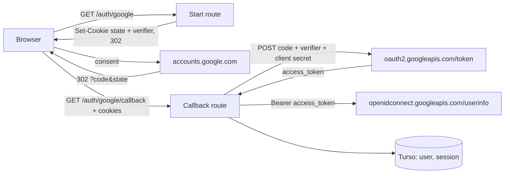

# Threat model: in-house Google OAuth client

- **Date:** 2026-11-07
- **Scope:** replacing the deprecated `arctic` library (issue #150) with our own code for the Google authorization-code flow with PKCE: generating `state` and the code verifier, building the authorization URL, and redeeming the code for an access token. The routes `/auth/google` and `/auth/google/callback` keep their current behaviour. Out of scope: sessions (`src/lib/server/auth.ts`), the userinfo request and profile mapping (`fetchGoogleProfile`), which do not change.

## Elements

| Assets                                                                                                                  | Actors                                                                                      | Entry points                                                                   | Trust boundaries                                                                                               |
| ----------------------------------------------------------------------------------------------------------------------- | ------------------------------------------------------------------------------------------- | ------------------------------------------------------------------------------ | -------------------------------------------------------------------------------------------------------------- |
| The Google client secret; the authorization code and code verifier; the access token; the visitor's account and session | A visitor signing in; an attacker who can send the victim a link or watch redirects; Google | `GET /auth/google`; `GET /auth/google/callback?code&state` (both rate-limited) | Browser to Worker (query string and cookies are untrusted); Worker to Google (outbound TLS to fixed endpoints) |

## Data flow

## Threats

| #   | STRIDE                 | Threat                                                                                                                                      | Likelihood | Impact | Existing control                                                                                                                  | Gap                                                                          | Mitigation                                                                                                                                                                                             | Verification                                                                                                                                                                             |
| --- | ---------------------- | ------------------------------------------------------------------------------------------------------------------------------------------- | ---------- | ------ | --------------------------------------------------------------------------------------------------------------------------------- | ---------------------------------------------------------------------------- | ------------------------------------------------------------------------------------------------------------------------------------------------------------------------------------------------------ | ---------------------------------------------------------------------------------------------------------------------------------------------------------------------------------------- |
| 1   | Spoofing               | Login CSRF: an attacker sends the victim a callback URL carrying the attacker's own code, signing the victim into the attacker's account.   | Medium     | Medium | `state` cookie compared with the query, both handshake cookies cleared before any check (rule 10, control 3 validates the query). | The new generator must stay unguessable.                                     | `state` and verifier are 32 bytes from `crypto.getRandomValues`, base64url without padding.                                                                                                            | Unit test: 43-character base64url values that differ between calls. Route test: a mismatching or missing `state` redirects to `/?auth=error` and sends no token request.                 |
| 2   | Tampering              | PKCE downgrade or a wrong challenge: without a correct S256 challenge, an intercepted code could be redeemed by someone else.               | Low        | High   | arctic always sent S256.                                                                                                          | Hand-written code could send `plain`, omit the challenge or hash it wrongly. | Always `code_challenge_method=S256`, the challenge being base64url(SHA-256(verifier)) from `crypto.subtle.digest`. No `plain` path exists.                                                             | Unit test against the RFC 7636 appendix B vector; URL test asserts the method and that the challenge matches the verifier; the e2e test already checks S256.                             |
| 3   | Information disclosure | The client secret reaches the browser or a log: put in the authorization URL by mistake, or embedded in an error message the callback logs. | Low        | High   | Server-only module (`#lib/server`, `$app/env/private`).                                                                           | Requests are now built by hand.                                              | The secret is only in the POST body to the fixed token endpoint. Errors carry the HTTP status and Google's `error` code, never the request, the response body, the code or the verifier.               | Unit tests: the authorization URL has no `client_secret`; a failed exchange throws a message that contains none of the secret, the code, the verifier or a token from the response body. |
| 4   | Tampering              | A malformed or unexpected token response (HTML error page, missing or non-string `access_token`) is trusted and passed on.                  | Low        | Medium | arctic checked `access_token` was a string.                                                                                       | No check exists until we write one.                                          | A non-200 status, a body that is not JSON, or one that fails a valibot schema (non-empty `access_token`, length capped) throws; the callback's existing `catch` turns every throw into `/?auth=error`. | Unit tests for a 200 with a valid body, a 400 `invalid_grant`, a 500, a non-JSON 200 and a 200 without `access_token`.                                                                   |
| 5   | Tampering              | An unmaintained dependency on the sign-in path: a future flaw in arctic or `@oslojs/*` would get no fix.                                    | Medium     | High   | None (the reason for issue #150).                                                                                                 |                                                                              | Remove `arctic`; the four deprecated `@oslojs/*` packages leave with it.                                                                                                                               | `npm ls arctic @oslojs/crypto` is empty and `npm ci` prints no deprecation warning for them.                                                                                             |

## Open mitigations

- [ ] Random `state` and verifier — verified by the generator unit test and the callback route tests (threat 1).
- [ ] S256 challenge — verified by the RFC 7636 vector test and the URL test (threat 2).
- [ ] Secret only in the token request, redacted errors — verified by the URL and error-message tests (threat 3).
- [ ] Validated token response — verified by the five token-response tests (threat 4).
- [ ] arctic removed — verified by `npm ls` and the `npm ci` output (threat 5).

## Accepted risks

- **`state` is compared with `!==`, not in constant time.** An attacker would have to guess a victim's 256-bit value over the network; a timing side channel does not make that practical. Unchanged from arctic.
- **No timeout on the token and userinfo requests.** Both go to Google, and the Worker runtime bounds the request; the sign-in rate limit (rule 10, control 5, 10 per minute per IP) caps how many can be in flight from one caller. Unchanged from arctic.
- **The ID token is not verified.** The profile comes from the userinfo endpoint over an authenticated TLS connection instead, as `fetchGoogleProfile` already documents. Unchanged.
