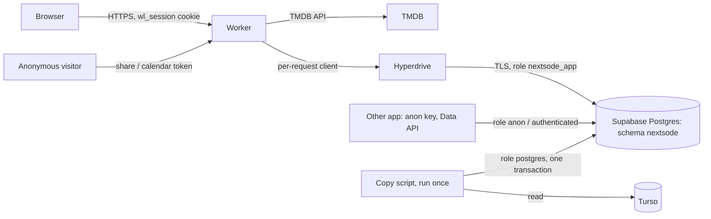

# Threat model: moving the database from Turso to Supabase Postgres

- **Date:** 2026-11-14
- **Scope:** issue #163. The data moves from Turso (libSQL) to a `nextsode` schema in a Supabase project that another app shares. The Worker reaches it through Hyperdrive as the `nextsode_app` role, under Row Level Security. TMDB metadata moves into a shared `media` table. Users, sessions and items are copied over once. Out of scope: the Google OAuth flow (see `2026-11-07-google-oauth-client.md`), which is unchanged; Supabase Auth, Storage and the Data API, which this app does not use.

## Elements

| Assets                                                                                                                                                                                                         | Actors                                                                                                                                                                                                                                                                                            | Entry points                                                                                                                                                                                                                                          | Trust boundaries                                                                                                                                                                                                                             |
| -------------------------------------------------------------------------------------------------------------------------------------------------------------------------------------------------------------- | ------------------------------------------------------------------------------------------------------------------------------------------------------------------------------------------------------------------------------------------------------------------------------------------------- | ----------------------------------------------------------------------------------------------------------------------------------------------------------------------------------------------------------------------------------------------------- | -------------------------------------------------------------------------------------------------------------------------------------------------------------------------------------------------------------------------------------------- |
| Account rows (email, name, avatar); session token hashes; the calendar and share tokens; every user's list; the `nextsode_app` password and the Hyperdrive config; availability of the shared Supabase project | A signed-in user; an anonymous visitor holding (or guessing) a share or calendar token; another account trying to reach someone else's rows; anyone with the project's `anon` key (it ships in the other app's client); the other app's code and migrations; the operator running the copy script | Every form action and load function (through `nextsode_app`); `/share/[token]` and the calendar feed (anonymous); sign-in callback and session validation (before a user is known); the copy script; the Supabase Data API (`anon` / `authenticated`) | Browser to Worker; Worker to Hyperdrive to Postgres (TLS); one database role to another inside Postgres (`nextsode_app`, `anon`, `authenticated`, `postgres`); TMDB responses to the shared `media` table; Turso to Supabase during the copy |

## Data flow

## Threats

| #   | STRIDE | Threat                                                                                                                                                                                                                            | Likelihood                                                               | Impact                                              | Existing control                                                | Gap                                                          | Mitigation                                                                                                                                                                                                                     | Verification                                                                                                                                                                               |
| --- | ------ | --------------------------------------------------------------------------------------------------------------------------------------------------------------------------------------------------------------------------------- | ------------------------------------------------------------------------ | --------------------------------------------------- | --------------------------------------------------------------- | ------------------------------------------------------------ | ------------------------------------------------------------------------------------------------------------------------------------------------------------------------------------------------------------------------------ | ------------------------------------------------------------------------------------------------------------------------------------------------------------------------------------------ |
| 1   | E, I   | The app connects as `postgres`, which has `BYPASSRLS`, or as the table owner, so the policies never apply                                                                                                                         | Medium (the connection string Supabase shows by default uses `postgres`) | High: isolation falls back to application code only | Control 6 is N/A today; `ownedRow` in the app                   | No database-level isolation                                  | `nextsode_app`: `LOGIN`, `NOSUPERUSER`, `NOBYPASSRLS`, not the owner of any object, with only the grants it needs. RLS enabled with default deny on every table                                                                | Test as `nextsode_app`: user A sees and changes none of B's rows, and with no user set every table reads empty. Test: `nextsode_app` has `rolbypassrls = false` and owns nothing           |
| 2   | I, S   | The user id set for one request survives on a pooled connection and the next request runs as that user                                                                                                                            | Medium (Hyperdrive reuses connections)                                   | High: one account reads another's list              | None (new)                                                      | Session-level settings would leak                            | Set the user only with `set_config(..., true)` inside the request's transaction. Never `SET` or session-level `set_config`                                                                                                     | Test: after a committed transaction on the same connection, `nextsode.current_user_id()` is null and every table reads empty                                                               |
| 3   | S, E   | The user id given to the database comes from the request (a form field or a query) instead of the validated session                                                                                                               | Low                                                                      | High                                                | `locals.user` is set only by `hooks.server.ts` from the session | The new helper could take any string                         | The only way to run user queries takes `locals.user` (a `SessionUser`), never a raw id from the request                                                                                                                        | Actions tests: a forged `userId` field changes nothing; review that every caller passes `locals.user`                                                                                      |
| 4   | E, I   | A `SECURITY DEFINER` function (`find_session`, `sign_in_google`, `shared_list`, `calendar_entries`) is callable by `anon` / `PUBLIC`, has a hijackable `search_path`, or returns more columns than its page shows (email, tokens) | Medium (functions are executable by `PUBLIC` by default)                 | High: the functions bypass RLS                      | None (new)                                                      | Default `EXECUTE` to `PUBLIC`                                | Every function: `SET search_path = ''`, fully qualified names, `REVOKE ALL FROM PUBLIC, anon, authenticated`, `GRANT EXECUTE` to `nextsode_app` only; explicit return columns; lookups by token hash or token with exact match | Tests: `anon` and `authenticated` get `permission denied` calling each function; the shared-list result has no email, token or other user's column; a wrong or empty token returns nothing |
| 5   | I      | Someone adds `nextsode` to the Data API's exposed schemas, or a default privilege grants `anon` / `authenticated` access, so the other app's public `anon` key reads WatchList data                                               | Low (needs a dashboard change)                                           | High: every list and email readable over HTTPS      | None                                                            | Supabase grants `anon` / `authenticated` broadly in `public` | Objects live outside `public`; no `USAGE` on `nextsode` for `anon`, `authenticated` or `PUBLIC`; RLS on everything as the second layer                                                                                         | Test as `anon` and `authenticated`: `permission denied` on the schema and on each table. Supabase security advisors clean after the cutover                                                |
| 6   | T      | A signed-in user posts a forged title, poster or overview, which now lands in the shared `media` row and shows on every other user's list, shared page and calendar                                                               | Medium (today's add form sends these fields)                             | Medium: content spoofing across accounts            | Svelte escapes output                                           | Shared rows would trust client fields                        | `media` rows are written only from TMDB responses on the server. The add action takes `tmdb_id` and `media_type` from the form, nothing else                                                                                   | Test: an add with forged metadata stores TMDB's values (stubbed), and another user's view is unchanged                                                                                     |
| 7   | D      | Connection exhaustion in the shared project: Workers open a client per request, and the Free plan caps direct connections, shared with the other app                                                                              | Low at this traffic                                                      | Medium: both apps fail                              | Rate limits (control 5)                                         | No pool cap                                                  | Hyperdrive pools; each request's lazy node-postgres pool uses at most one connection and closes it when the response is done                                                                                                   | Locally: a burst of 100 requests leaves `pg_stat_activity` for `nextsode_app` bounded and returns to 0                                                                                     |
| 8   | T, I   | The copy script stops half way, writes duplicates, or leaves an export with personal data on disk                                                                                                                                 | Low                                                                      | Medium                                              | None (new)                                                      | —                                                            | One transaction; refuses to run on a non-empty target; streams from Turso to Postgres without writing files; reads credentials from environment variables, never arguments                                                     | Dry run against the local container: counts and sampled rows match, a second run is refused, and the run writes no files                                                                   |
| 9   | I      | Traffic between Hyperdrive and Supabase without TLS                                                                                                                                                                               | Low                                                                      | High                                                | Hyperdrive uses TLS                                             | Supabase accepts non-TLS unless enforced                     | Turn on SSL enforcement in the project during the cutover                                                                                                                                                                      | A connection with `sslmode=disable` is rejected                                                                                                                                            |
| 10  | E      | The other app's migrations or code (also with `postgres`) alter or read `nextsode`                                                                                                                                                | Low                                                                      | Medium                                              | The same person owns both                                       | Shared superuser-like role                                   | Each app keeps to its own schema; drizzle's migrations table lives in `nextsode`                                                                                                                                               | Review the other app's migrations before the cutover                                                                                                                                       |

## Open mitigations

- [ ] `nextsode_app` role and default-deny RLS — verified by the cross-account and no-user tests (1, 3)
- [ ] Transaction-local user setting — verified by the pooled-connection test (2)
- [ ] Hardened `SECURITY DEFINER` functions — verified by the role and column tests (4)
- [ ] No `anon` / `authenticated` access to `nextsode` — verified by the role tests and the advisors (5)
- [ ] `media` written only from TMDB — verified by the forged-add test (6)
- [ ] Bounded connections — verified by the local burst (7)
- [ ] Safe copy script — verified by the dry run (8)
- [ ] SSL enforcement — verified at the cutover (9)

## Accepted risks

- Anyone holding the project's `postgres` credentials (the owner, and the other app's tooling) can read every row. It is the same person and the same trust, as with the Turso token today.
- No audit log of changes. Each row has a single owner who acts only on their own data, and the user asked for no copy to be kept after deletion.
- `media` rows remain after the last list referencing them is deleted. They hold only public TMDB data, never anything about a user.
